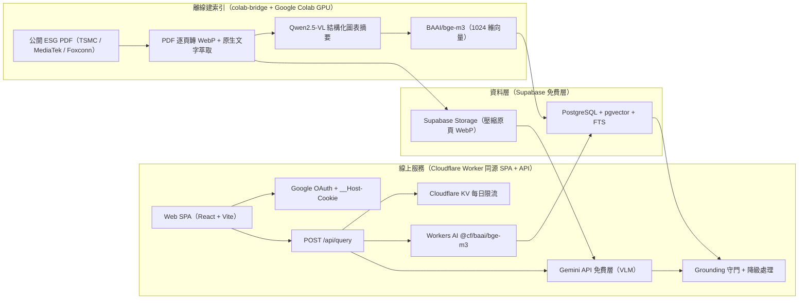
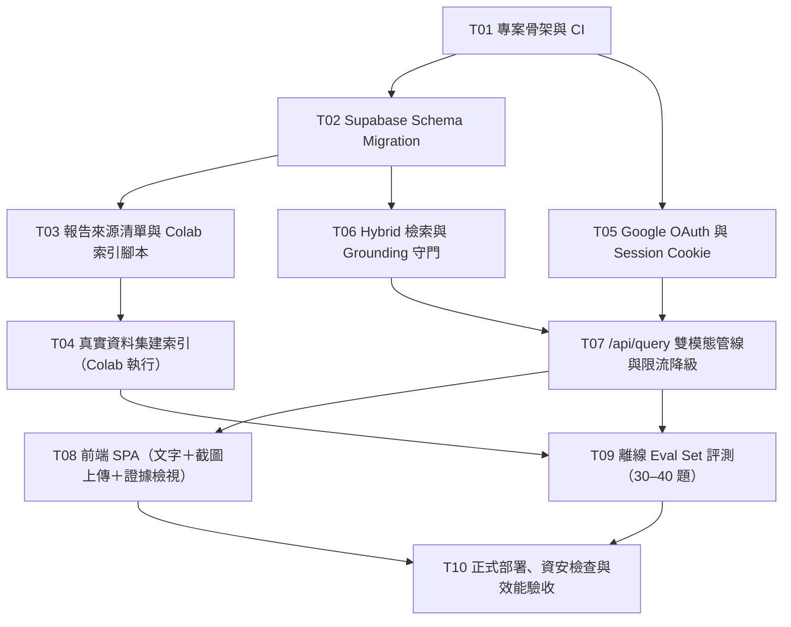

# 03 — 系統設計與架構決策（System Design & ADRs）

- **文件狀態**：提案（待擁有者核准）
- **建立日期**：2026-11-20

---

## 1. 系統架構圖



---

## 2. 關鍵架構決策（ADRs）

### ADR-001：離線 VLM 結構化摘要 ＋ 單向量檢索 ＋ 線上原圖送 VLM（不採用 ColPali）
- **背景**：需在 Supabase 免費層（500 MB DB）與 Cloudflare Worker CPU 限制下支援 180–240 頁高密度圖表 PDF 檢索。
- **選項**：
  1. **ColPali multi-vector**：每頁產生約 1,000+ 個 128 維 patch 向量，240 頁即約 25 萬筆向量，易逼近免費層 DB 與查詢延遲上限，且線上查詢無法在 Workers AI 直接跑 ColPali encoder。
  2. **Hybrid 單向量（BGE-M3）＋ 離線 VLM 結構化摘要 ＋ 線上原圖送 VLM（採用）**：每頁 1 筆 1024 維向量（240 頁僅 ~15 MB），離線與線上共用同模型 `bge-m3`，檢索出 Top-3 頁後直接把**原頁圖**交給 Gemini VLM 讀圖作答。
- **取捨**：依賴離線 VLM 摘要品質確保圖表能被召回（透過 Recall@5 ≥ 85% 評測把關）；換來極低儲存佔用、零月費與數秒內回應。

### ADR-002：Google OAuth Owner 白名單 ＋ `__Host-` HttpOnly Session Cookie
- **背景**：MVP 僅供擁有者使用，需防止未授權存取消耗免費 API 額度，並遵守 `DeploymentHandbook.md` 2.1 節。
- **決策**：
  - 網頁與 API 部署於同一個 Cloudflare Worker（`multi-modal-rag.curio-lab.workers.dev`），獨立 origin、不開 CORS。
  - 採 Google OAuth 2.0 Authorization Code + PKCE，驗證 `email_verified === true` 與 `OWNER_EMAIL_ALLOWLIST`。
  - Session 使用 HMAC-SHA256 簽章（或標準 JWT），透過 Harbor 範本 `session-cookie.ts` 存入 `__Host-mmrag_session`（`HttpOnly; Secure; SameSite=Strict; Path=/`），絕不存 `localStorage`。
- **Rollback／未來切換**：Phase 2 若開放公開展示，可透過環境開關調整為公開唯讀模式＋IP 限流，不需重寫核心檢索管線。

### ADR-003：使用 Supabase（`pgvector` + Storage）而非 Cloudflare R2／Vectorize
- **背景**：依 `DeploymentHandbook.md` 第 3 節，不得開啟需綁定信用卡之服務。
- **決策**：Cloudflare R2 與 Vectorize 啟用通常需要綁卡，因此向量與頁圖儲存改用已驗證免綁卡的 Supabase 免費方案（500 MB DB + 1 GB Storage）。
- **限制與應對**：Supabase 免費專案 7 天無活動會暫停；MVP 階段接受冷啟動喚醒，若後續需要常駐再另行評估。

---

## 3. 資料模型（Supabase PostgreSQL Migration 草案）

- `reports`：
  - `id` (text PK, e.g. `tsmc-esg-2024`)
  - `company` (text, not null)
  - `report_year` (int, not null)
  - `title` (text, not null)
  - `source_url` (text, not null)
  - `dataset_version` (text, not null)
  - `total_indexed_pages` (int, not null)
  - `created_at` (timestamptz)
- `report_pages`：
  - `id` (uuid PK)
  - `report_id` (text FK → `reports.id`)
  - `page_number` (int, not null; unique with `report_id`)
  - `section_title` (text)
  - `raw_text` (text)
  - `visual_summary` (text, not null — 離線 VLM 產出之圖表、表頭、單位與數值摘要)
  - `has_chart` (boolean, not null default false)
  - `image_path` (text, not null — Supabase Storage 路徑)
  - `embedding` (`vector(1024)`, not null — BGE-M3)
  - `search_tsv` (`tsvector` generated — 全文檢索欄位)
- RPC Function：`match_report_pages(query_embedding vector(1024), query_text text, filter_company text, filter_year int, match_count int)`，回傳結合向量相似度與全文檢索的 RRF（Reciprocal Rank Fusion）排序結果。

---

## 4. API 契約（同源 `/api/*`）

| 端點 | 方法 | 權限 | 說明 |
|---|---|---|---|
| `/api/health` | `GET` | 公開 | 健康檢查，回傳 `{ status: "ok", version, dataset_version }` |
| `/api/auth/login` | `GET` | 公開 | 啟動 Google OAuth + PKCE 流程 |
| `/api/auth/callback` | `GET` | 公開 | 驗證 state／白名單並簽發 `__Host-mmrag_session` |
| `/api/auth/me` | `GET` | 需登入 | 回傳 `{ authenticated: true }`（不回傳原始 email 以外的敏感欄位） |
| `/api/auth/logout` | `POST` | 需登入 | 驗證同源並清除 session cookie |
| `/api/reports` | `GET` | 需登入 | 列出已收錄報告清單與 `dataset_version` |
| `/api/query` | `POST` | 需登入 | `multipart/form-data`（`question` 文字、可選 `image` 單檔 ≤ 2 MB、可選 `company`、`year`），回傳 `QueryResponse` |

`QueryResponse` 核心欄位：
```ts
type QueryStatus = "grounded" | "refused" | "degraded_retrieval_only";

interface Citation {
  report_id: string;
  company: string;
  report_year: number;
  page_number: number;
  section_title: string | null;
  image_url: string;
  source_url: string;
  relevance_score: number;
  visual_excerpt: string;
}

interface QueryResponse {
  request_id: string;
  status: QueryStatus;
  answer: string;
  refusal_reason: string | null;
  extracted_image_query: string | null;
  citations: Citation[];
  latency_ms: number;
}
```

---

## 5. Task DAG 與任務契約（MVP）



| Task ID | Goal | Input contract | Output artifact | depends_on | Out of scope | Acceptance checks | Fixture / test data | Evidence path |
|---|---|---|---|---|---|---|---|---|
| **T01** | 建立 Worker + React/Vite 專案骨架與 CI | `docs/01`～`03` | `package.json`, `wrangler.toml`, `tsconfig`, `.github/workflows/ci.yml` | — | 商業邏輯、正式部署 | lint、typecheck、unit test、`progress.md <= 100` 行檢查全過 | 最小 health test | CI run log |
| **T02** | 建立 Supabase schema 與 Hybrid RPC migration | §3 資料模型 | `migrations/0001_init.sql`, 型別與 DTO | T01 | 實際灌入報告 | SQL 語法檢查＋離線 DTO 契約測試 | 合成 3 筆頁資料 fixture | `tests/schema/` |
| **T03** | 定義 3 家 ESG 報告來源清單與 `colab-bridge` 離線索引腳本 | 公開報告 URL 清單 | `corpus/sources.json`, `colab-bridge` 索引腳本 | T02 | 實際跑完 240 頁 GPU | 腳本單元測試＋單頁 dry-run 驗證 | 合成 2 頁樣本 PDF | `tests/indexing/` |
| **T04** | 於 Colab GPU 執行 180–240 頁索引並寫入 Supabase | T03 腳本＋真實公開 PDF | Supabase 實資料＋`dataset_version` 紀錄 | T03 | 線上查詢 API | 頁數、向量維度、Storage 圖片可讀、CU 消耗紀錄 | 真實公開 ESG 報告 | `docs/evidence/indexing-run.md` |
| **T05** | 實作 Google OAuth + PKCE + `__Host-` cookie + 同源檢查 | ADR-002, `session-cookie.ts` | `src/auth/*`, middleware | T01 | 查詢 API | 未登入 401、非白名單 403、跨站 POST 403、登出清 cookie | Fake OAuth provider | `tests/auth/` |
| **T06** | 實作 Hybrid 檢索、相似度門檻拒答與 Grounding 守門 | T02 DTO, FR-04 | `src/retrieval/*`, `src/grounding/*` | T02 | 真實 VLM 呼叫 | 合法引用保留、偽造頁碼攔截、低分直接拒答 | 離線檢索 fixture | `tests/grounding/` |
| **T07** | 實作 `/api/query`（文字＋截圖 magic bytes 驗證＋Gemini VLM＋KV 限流降級） | T05, T06, §4 API 契約 | `src/query/*`, `src/llm/*` | T05, T06 | 前端 UI | 截圖驗檔、429 降級 `degraded_retrieval_only`、KV 限流測試 | Fake Gemini/Workers AI/KV | `tests/query/` |
| **T08** | 實作同源前端 SPA（登入頁、文字／截圖貼上上傳、引用原頁放大檢視） | §2 流程, T07 API | `web/*`, `public/_headers` | T07 | 正式上線 | 元件測試＋本機瀏覽器驗證（桌機與手機視窗）＋無 CSP 錯誤 | Mock API fixture | `tests/web/` |
| **T09** | 建立 30–40 題離線 Eval Set 並執行準確率評測 | T04 真實索引, T07 管線 | `eval/dataset.json`, 評測腳本與報告 | T04, T07 | 正式效能壓測 | Recall@5 ≥ 85%、引用合法率 100%、正確拒答率 ≥ 90% | 真實 ESG 評測題庫 | `docs/evidence/eval-report.md` |
| **T10** | 正式部署至 Cloudflare Worker、資安基準逐項驗證與效能驗收 | T08, T09, 擁有者 Secrets | `.github/workflows/deploy.yml`, Release Gate 報告 | T08, T09 | 公開開放給大眾 | 正式實機登入／查詢／截圖／登出、p50/p95 達標、安全標頭驗證 | 正式環境實測 | `docs/evidence/mvp-release-gate.md` |
